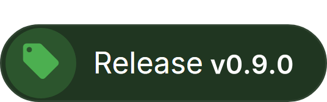
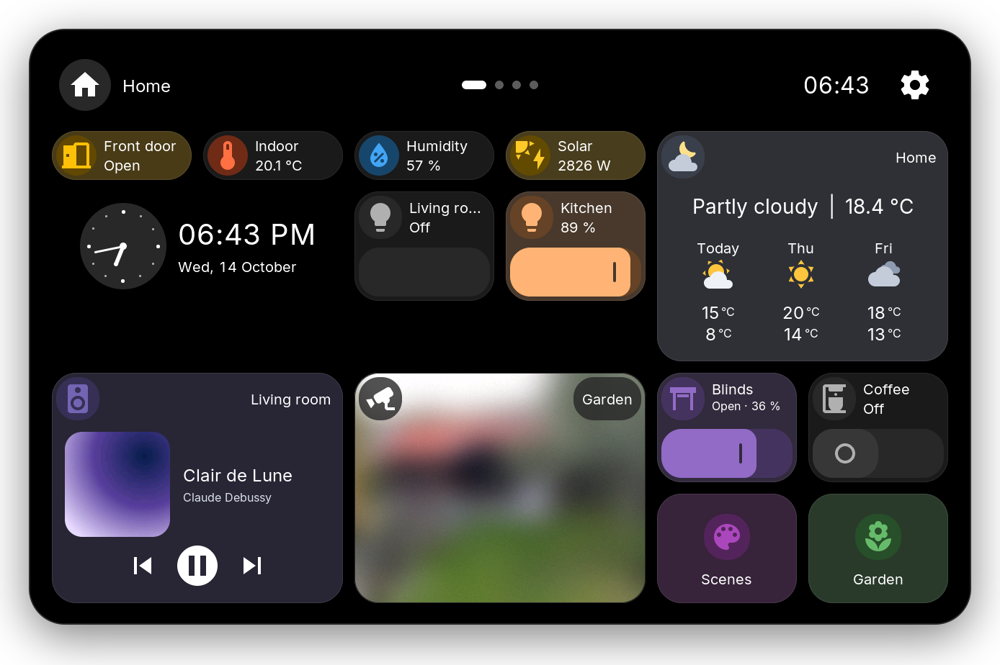
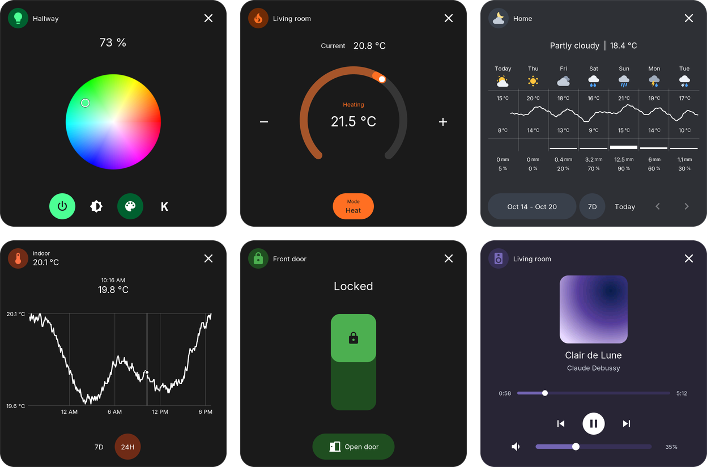
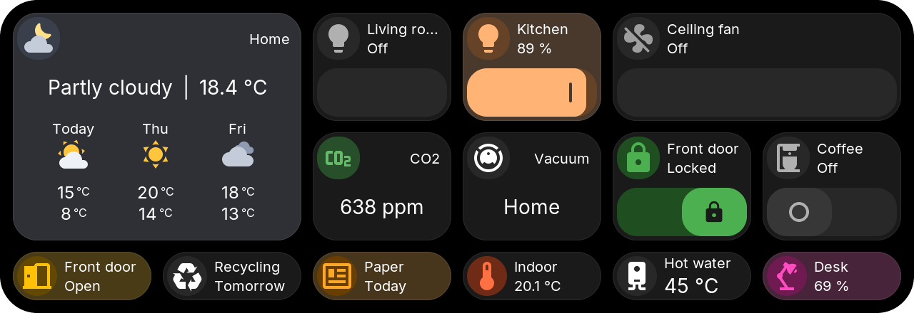
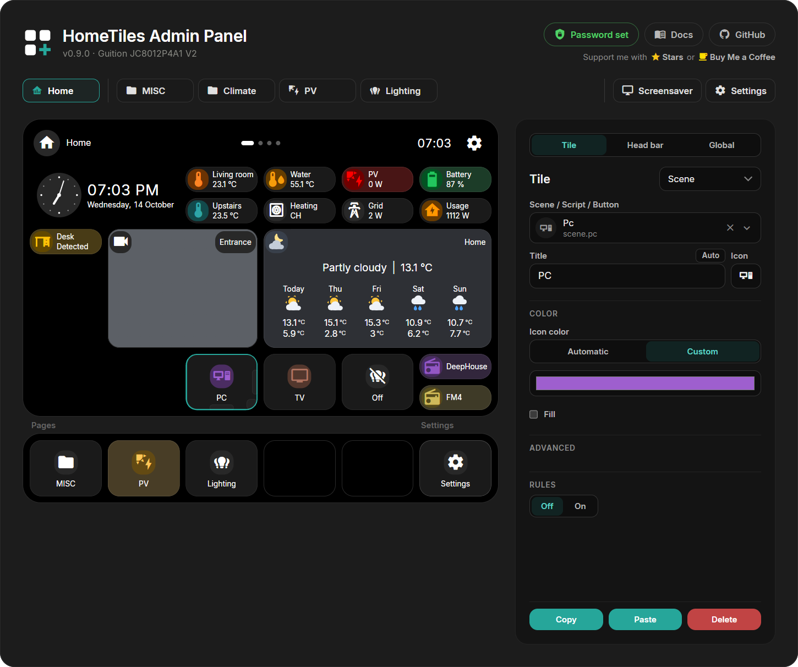

<picture>
  <source media="(prefers-color-scheme: dark)" srcset="docs/images/readme-brand-dark.png">
  
</picture>

Touch dashboards for Home Assistant on ESP32 displays. 
Lights, climate, sensors, energy, weather, cameras and more on a 4 to 10.1 inch touch screen.

 
 
Every tile opens a popup with its controls and history.

## Screenshots

### Popups

### Tiles

### Web Admin

Build the dashboard in the browser; the Web Admin preview matches the display.

## New in v0.9.0

- **[Direct link to Home Assistant](https://galusperes.github.io/installer/#set-up-the-display):** press Pair on the display and add it in Home Assistant. No MQTT broker needed; existing MQTT setups keep working.
- **[Head bar and pages](https://galusperes.github.io/device-ui/#head-bar-and-pages):** fewer, larger tiles under a head with title, time and gear, up to five folders as pages beside Home, and an [upright layout](https://galusperes.github.io/device-ui/#layouts) for ESP32-P4 displays.
- **[Light theme](https://galusperes.github.io/device-ui/#light-theme):** Dark, Light or Automatic, on the display and in the Web Admin.
- **[New Settings](https://galusperes.github.io/device-ui/#settings):** on the display, with a first-start setup in four steps.
- **[Entity picker](https://galusperes.github.io/web-admin/#creating-a-tile):** searches every entity like Home Assistant, with Recent and Favorites on top.
- **[Clock](https://galusperes.github.io/tiles/#clock) and [Camera](https://galusperes.github.io/tiles/#camera) tiles:** analog and wall clocks, camera tiles that show the picture, and cameras in full screen.

Before updating, update HomeTiles Bridge to **v0.9.0** and [export your dashboard](https://galusperes.github.io/updating/). [All changes](docs/releases/v0.9.0.md)

## Get started

You need a compatible display, Home Assistant and [HomeTiles Bridge](https://github.com/GalusPeres/HomeTiles-Bridge).

1. Find your exact model in the [device list](https://galusperes.github.io/#device-support).
2. Follow the [installation](https://galusperes.github.io/installer/): flash the display in the browser, install the Bridge, pair the display and add your tiles.

## Help

[Firmware updates](https://galusperes.github.io/updating/) · [Troubleshooting](https://galusperes.github.io/faq/) · [Report a problem](https://github.com/GalusPeres/HomeTiles/issues) · [Contribute](CONTRIBUTING.md) · [Architecture](ARCHITECTURE.md)

HomeTiles is free and open source under the [MIT License](LICENSE).
